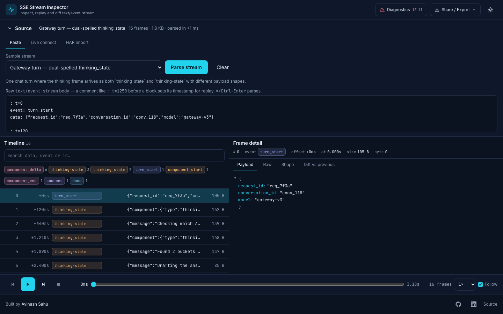

# SSE Stream Inspector

Inspect, replay and diff Server-Sent Events streams — and catch the bugs a plain network tab hides: the same event arriving under two spellings, payload shapes drifting mid-stream, duplicate or regressing ids, dead turns with no terminal event.

**Live demo:** https://avinash9694.github.io/sse-stream-inspector/



## Why I built this

I work on a desktop client for an LLM chat gateway that speaks `text/event-stream`. One week a turn's "work fold" rendered one line out of five with no error, no log and a 200 response: the gateway was sending the same frame as both `thinking_state` and `thinking-state`, with a different payload shape under each spelling, and a `switch` on one literal silently dropped the other. Nothing in DevTools made that visible — the EventStream tab lists frames, it does not compare them. This tool is the inspector I wanted that day: a spec-compliant parser you can feed anything, structural analysis across the whole stream, and replay with the original timing so a race can be watched instead of imagined.

## The bug this catches

Load the default sample (or paste the snippet below) and open **Diagnostics**:

```
event: thinking_state
data: {"component":{"type":"thinking","props":{"children":"Reading context"}},"state":"active"}

event: thinking-state
data: {"message":"Checking which accounts are in scope","state":"active"}
```

The headline finding reads **“Event spelled 2 ways: thinking-state / thinking_state”** at error severity, because the two spellings normalise to one event _and_ carry different shapes (`$.component.props.children: string` vs `$.message: string`). A client matching one literal drops the other and renders a partial stream. Clicking the finding highlights every frame involved; the **Shape** tab shows each payload's signature and **Diff vs previous** shows exactly which paths changed between consecutive frames of that event.

Chips are coloured by _normalised_ event name on purpose, so spelling variants of one event share a colour and differ only in text — the eye catches the inconsistency before the diagnostics do.

## Features

- **Spec-compliant streaming parser** — `event:`, multi-line `data:` joined with `\n`, `id:`, `retry:`, comments, BOM, CRLF/CR/LF, lines and multibyte UTF-8 split across chunk boundaries. Non-dispatchable blocks (comment-only keep-alives, blocks with no `data:`) are still shown, flagged, so heartbeats and lost events are visible rather than silently discarded.
- **Four ways in** — paste raw text (with sample streams), connect live via `fetch` + `ReadableStream` (custom method, headers and body; an `EventSource` mode for GET-only servers), drop a HAR file and pick the event-stream entry, or import a previously exported session.
- **Diagnostics** — event-name variants (case, `_`/`-`, trailing `s`, `[DONE]` vs `done`) with per-variant counts and shape comparison; shape drift per event graded as _info_ for optional fields and _warning_ for a leaf changing type; duplicate and regressing ids; silences above a configurable threshold; missing terminal event against a configurable list (event names or data literals); broken JSON, unknown fields, non-numeric `retry`, truncated final block. Each finding jumps to and highlights its frames.
- **Token stats** for `*_delta` / `delta`-style frames: count, characters, chars/s, frames/s.
- **Replay** with original inter-arrival timing at 0.5×–8×, play/pause/step/step-back, a scrubber, and a follow mode that keeps the detail pane on the newest frame. Pasted text carries timing through `: t=<ms>` comment annotations.
- **Frame detail** — collapsible JSON tree, raw block, shape signature (sorted leaf paths, array-length and key-order independent), and a structural diff against the previous frame of the same event.
- **Built for volume** — virtualised timeline (`@tanstack/react-virtual`), parsing in a Web Worker, memoised payload analysis; the bundled stress sample is 10,000 frames.
- **Share and export** — copy a link that compresses the pasted stream into the URL hash (under 30 KB), export the session as JSON (frames + timing + source) or as raw `text/event-stream`.
- Dark-first theme following `prefers-color-scheme` with a persisted toggle; keyboard-driven (↑/↓/Home/End in the timeline, Space to play, `.`/`,` to step, `d` for diagnostics, Esc to close); responsive from 360px.

## Architecture

```
src/core/                      pure TypeScript, no React, fully unit-tested
  sse-parser.ts                streaming parser (push chunks, dispatch on blank line)
  payload.ts                   JSON parse + shape signature + shape diff (memoised per frame)
  normalize.ts                 event-name normalisation used by variants + terminal matching
  diagnostics/                 one module per check, runDiagnostics() aggregates + ranks
  replay.ts                    ReplayScheduler with injectable clock/timers
  session.ts · har.ts · share.ts · json-diff.ts · timing.ts · samples/

src/worker/parse-worker.ts     parse + timing off the main thread (inline fallback)
src/app/                       zustand store, loaders, live connection, theme
src/components/                source panel · timeline · detail pane · replay bar · diagnostics drawer
scripts/demo-server.mjs        zero-dependency Node SSE server with CORS for live mode
```

The split is deliberate: everything that decides _what is wrong with a stream_ lives in `src/core` and runs identically in the worker, in tests and in Node, while the React layer only renders what the core reports.

## Tech stack

React 18 · TypeScript (strict, `noUncheckedIndexedAccess`) · Vite 7 · Tailwind CSS 4 · zustand · @tanstack/react-virtual · microdiff · lz-string · Vitest + Testing Library · ESLint (typescript-eslint strict, react-hooks, jsx-a11y) · Prettier · GitHub Actions → Pages

## Running locally

```bash
npm install
npm run dev            # http://localhost:5173/sse-stream-inspector/
```

To try **Live connect** against a real stream, run the bundled demo server in a second terminal:

```bash
npm run demo-server    # http://localhost:8787
```

It serves `/stream/dual-spelling`, `/stream/chat-completions` and `/stream/heartbeat` with CORS enabled (`?speed=2` plays faster). In the app choose _Live connect_, keep the default URL and press **Start**. Any other server works as long as it sends `Access-Control-Allow-Origin` for the page's origin — the request is made by the browser, there is no proxy.

## Testing

```bash
npm test               # watch mode
npm run test:run       # once
npm run lint && npm run typecheck && npm run build
```

107 tests across 12 files: parser spec cases (chunk splits, CRLF/CR, BOM, comments, multi-line data, 10k-frame timing), shape signatures and diffs, every diagnostic with positive and negative cases, the replay scheduler under fake timers (speed, pause/resume, seek, step), HAR extraction (base64, sniffing), share-link round-trips and size limits, session import/export, and a UI smoke suite (boot with sample, diagnostics drawer, jump-to-frame, keyboard navigation, error state, footer).

## Project structure

```
.github/workflows/deploy.yml   lint → typecheck → test → build → Pages
public/favicon.svg
scripts/demo-server.mjs
src/
  app/            store, loaders, live connection, theme, App shell
  components/     ui primitives, source/, timeline/, detail/, replay/, diagnostics/
  core/           parser, payload analysis, diagnostics, replay, session, HAR, share, samples
  utils/          formatting helpers
  worker/         parse worker + client
```

## Roadmap and known limitations

- **Live connect is subject to CORS.** The page cannot reach a server that does not allow its origin; there is no relay. The demo server exists for exactly that reason.
- **EventSource mode only sees events whose names you list** (plus `message`), cannot send headers or a body, and never exposes `id:`/comments — that is the API's limit, which is why `fetch` mode is the default.
- **HAR files carry no per-event timing**, so imported frames get synthetic 40 ms spacing. Same for pasted text without `: t=` annotations.
- Share links are capped at ~30 KB after compression; larger captures go through session JSON export.
- Shape signatures treat array elements as a union, so `[1, "a"]` and `["a", 1]` are the same shape — intended, but it means positional tuples are not distinguished.
- Possible next steps: WebSocket and NDJSON transports, a side-by-side diff of two whole sessions, and persisting recent sessions in IndexedDB.

## License

[MIT](LICENSE)
